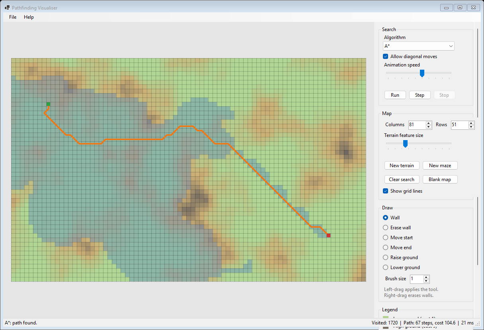
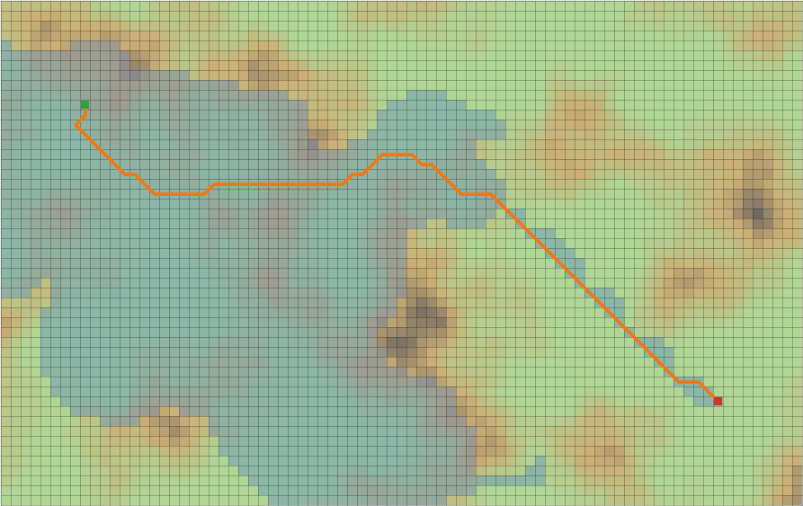
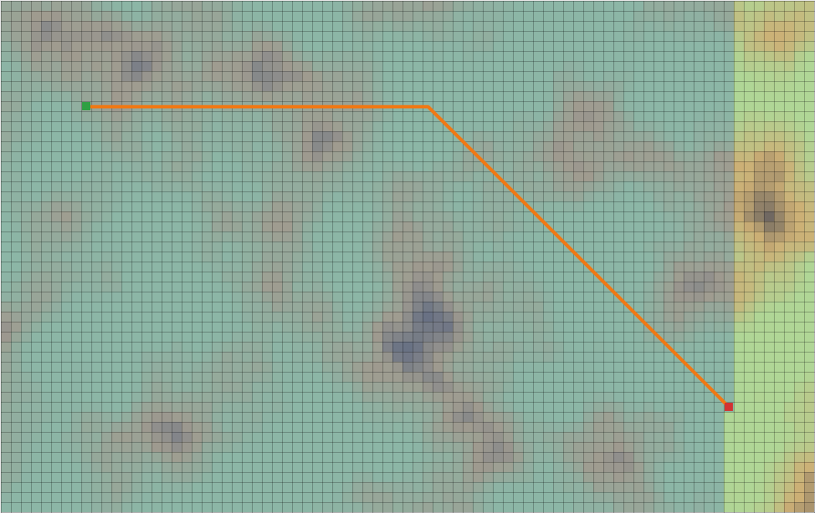
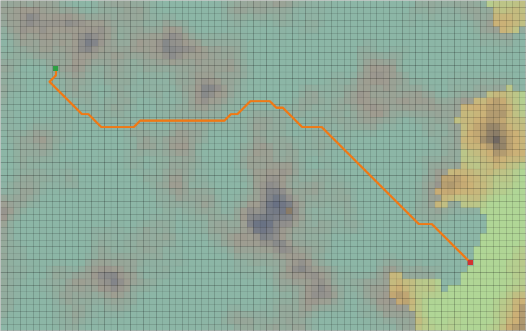
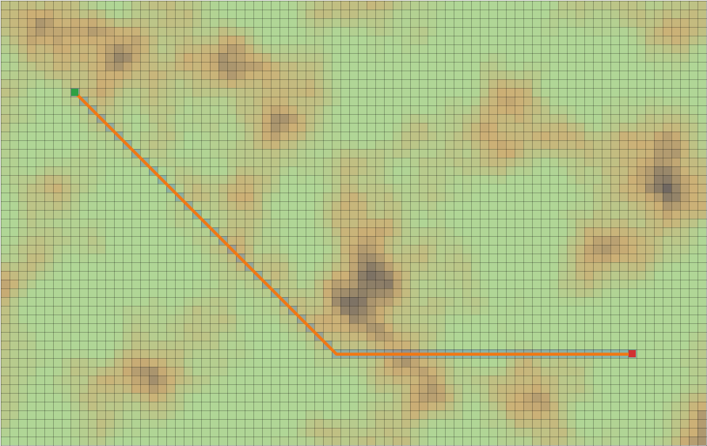
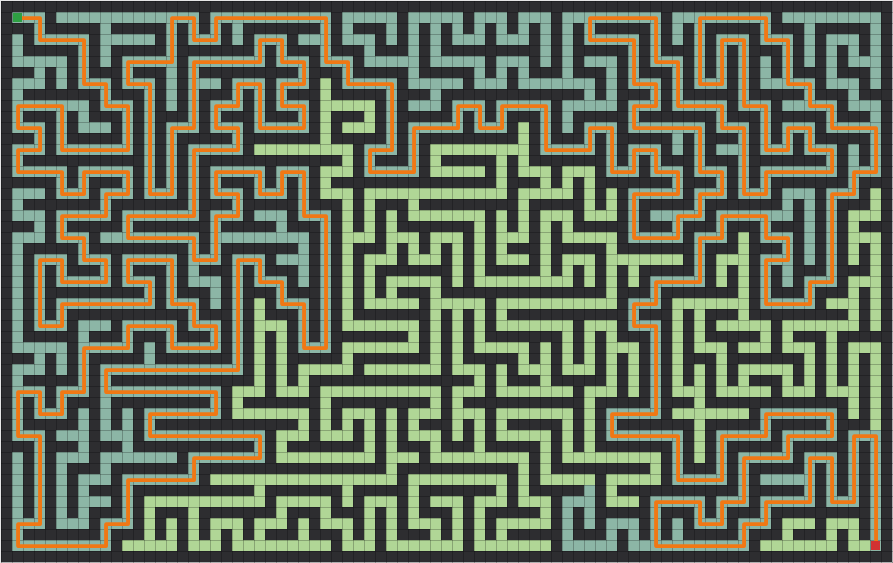
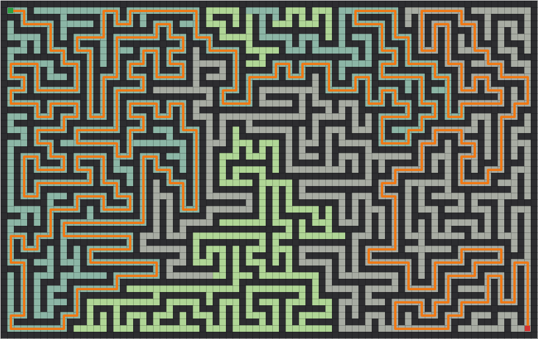

# Pathfinding Visualiser

A Windows desktop app that generates terrain or mazes and animates six search algorithms finding a route across them. Written in C# with Windows Forms.

Originally my A-Level Computer Science coursework at Rochdale Sixth Form College. This repository is a cleaned-up rewrite of that project on .NET 8, keeping the same design: a weighted grid, Perlin-noise terrain, a maze generator, and step-by-step animation of each algorithm so you can see how they differ.



## What it does

- **Generates maps.** Perlin-noise terrain where height sets the cost of each cell (1 on the plains, up to 9 on the hills), or a perfect maze from a recursive-backtracker generator.
- **Lets you edit the map.** Draw and erase walls, raise and lower the ground, move the start and end points, change the grid size and brush size.
- **Animates the search.** Watch the visited set and frontier grow one cell at a time, pause, single-step, or run at full speed.
- **Compares algorithms.** A*, Dijkstra, greedy best-first, breadth-first, bidirectional breadth-first and depth-first search, with cells visited, path length, path cost and time shown in the status bar.
- **Exports images.** `File > Save image` saves the current view, and a command-line mode renders a result without opening a window.

## Algorithms

| Algorithm | Uses terrain cost | Cheapest path guaranteed | Notes |
|---|---|---|---|
| A* | Yes | Yes | Dijkstra plus an octile-distance heuristic, so it expands far fewer cells |
| Dijkstra | Yes | Yes | Expands cells in order of cost so far |
| Greedy best-first | No | No | Heads straight for the goal; fast but easily fooled by hills and walls |
| Breadth-first (BFS) | No | Fewest steps only | Treats every step as cost 1, so it walks straight over hills |
| Bidirectional BFS | No | Fewest steps only | Two BFS fronts, one from each end, that stop when they meet |
| Depth-first (DFS) | No | No | Included for comparison; finds long, winding paths |

Diagonal moves are optional, cost 1.41x, and are not allowed to cut the corner of a wall. The A* heuristic is octile distance times the minimum cell cost, so it never overestimates and A* stays optimal.

## Software

- C# 12 on .NET 8 (Windows Forms), no external packages
- Builds with the .NET 8 SDK from the command line or in Visual Studio 2022

## How to run

Install the [.NET 8 SDK](https://dotnet.microsoft.com/download/dotnet/8.0), then:

```bash
git clone https://github.com/siamct/pathfinding-visualiser.git
cd pathfinding-visualiser
dotnet run --project PathfindingVisualiser -c Release
```

Or open `PathfindingVisualiser.sln` in Visual Studio and press F5.

Controls:

| Action | How |
|---|---|
| Apply the selected draw tool | Left-click or drag on the grid |
| Erase walls | Right-click or drag |
| Run / pause | `Run` button or `Space` |
| Single step | `Step` button or `Right arrow` |
| New terrain / new maze | `T` / `M` |
| Clear search | `C` |
| Select a draw tool | `1` to `6` |

To render a result to a PNG without opening a window:

```bash
PathfindingVisualiser.exe --export out.png astar terrain 2024
PathfindingVisualiser.exe --export out.png bds maze 7
```

The arguments are the output file, the algorithm (`astar`, `dijkstra`, `greedy`, `bfs`, `bds`, `dfs`), the map type (`terrain`, `maze` or `window` for a screenshot of the whole app) and a seed.

## Results

All six algorithms on the same 81 x 51 terrain (seed 2024) with diagonal moves on. Visited counts are cells expanded; cost is the sum of the terrain costs along the path.

| Algorithm | Cells visited | Path steps | Path cost |
|---|---|---|---|
| A* | 1,720 | 67 | 104.6 |
| Dijkstra | 3,681 | 67 | 104.6 |
| Greedy best-first | 65 | 64 | 178.5 |
| Breadth-first | 3,713 | 64 | 155.2 |
| Bidirectional BFS | 3,361 | 64 | 152.3 |
| Depth-first | 2,495 | 94 | 274.0 |

A* and Dijkstra find the same cheapest route, but A* expands less than half as many cells. The unweighted searches find paths with fewer steps that cost 50 to 160 percent more because they go straight over the hills.

| A* | Breadth-first |
|---|---|
|  |  |

| Dijkstra | Greedy best-first |
|---|---|
|  |  |

On a maze every open cell costs the same, so the difference is only in how many cells each algorithm has to look at before it finds the exit.

| A* on a maze | Bidirectional BFS on a maze |
|---|---|
|  |  |

## Project structure

```
PathfindingVisualiser/
  Grid/          Cell and Map: the weighted grid and neighbour lookup
  Generation/    PerlinNoise, TerrainGenerator, MazeGenerator
  Search/        One class per algorithm, all written as step iterators
  UI/            MainForm (controls), GridPanel (drawing and mouse), HeadlessExport
docs/            Images used in this README
```

Each algorithm is an iterator that yields a cell every time it expands one. The form pulls a few cells per timer tick to animate, and the exporter pulls them all in a loop. The same code produces both.

## What I learned

- **Why A* needs an admissible heuristic.** Scaling the distance estimate by the average terrain cost makes A* faster, but it can then return a worse path than Dijkstra. Scaling by the minimum cost keeps it optimal, at the price of expanding more cells on hilly maps.
- **Priority queues need stale-entry handling.** Re-inserting a cell with a lower cost and skipping entries that are already closed is simpler and faster than a decrease-key operation.
- **Corner cutting matters.** Allowing diagonal moves between two walls looked wrong immediately. Checking that both orthogonal neighbours are open is a one-line fix that most tutorials skip.
- **Separating the algorithm from the animation.** Writing each search as an iterator meant the UI, the single-step button and the headless exporter all share one implementation, and a bug in the search only has to be fixed in one place.
- **WinForms layout.** AutoSize containers nested inside each other can collapse to nothing. Fixed widths with content-sized heights were more predictable.

## Licence

MIT. See [LICENSE](LICENSE).
